  

  
  

### Sobre mim

- 🔬 Pesquisador FAPES no **LAIR (Ifes)**: visão computacional e otimização para a indústria de rochas ornamentais
- 🚀 Fundador da **Petra Smart** e sócio da **Wisestone Tech**
- 🌱 Estudando Machine Learning e Sistemas Distribuídos
- 🥋 Fora do teclado: jiu-jitsu e jogos competitivos
- ⚡ Se não sei, aprendo. Se não funciona de um jeito, tento de outro.

### Projetos

| | Projeto | Stack |
|:-:|:--|:--|
| 🪨 | **Petra Smart** IA que transforma retalhos de rocha em mosaicos |    |
| 🧩 | **Nesting de retalhos** Empacotamento irregular reprodutível, ~86% de aproveitamento |    |
| 📷 | **Wisestone Tech** Digitalização de chapas em produção, ~1.500/mês |    |
| ✅ | **QRCheck** Presença por QR Code no Ifes, +1.100 participantes |    |
| 🛒 | **VVN** API de e-commerce com PIX, frete e CI/CD |     |

### Publicações e prêmios

- 📄 **SBAI 2025** · Visão computacional e otimização para mosaicos de rochas (1º autor)
- 📄 **Latin.Science 2026** · Solver aberto de empacotamento irregular (1º autor)
- 📄 **Revista FOCO 2023** · Economia do setor de rochas do ES na pandemia (coautor)
- 🏆 **Gênesis FAPES 2025** (vencedor) · **Centelha 3 ES** · **Hackathon Latinoware 2023** (vencedor)

### Stack

  
  
  
  
  
  
  
   
  
  
  
  
  
  
  
  

### Stats

  
  

  <picture>
    <source media="(prefers-color-scheme: dark)" srcset="https://raw.githubusercontent.com/MarcosAMPaes/MarcosAMPaes/output/github-contribution-grid-snake-dark.svg" />
    <source media="(prefers-color-scheme: light)" srcset="https://raw.githubusercontent.com/MarcosAMPaes/MarcosAMPaes/output/github-contribution-grid-snake.svg" />
    
  </picture>

